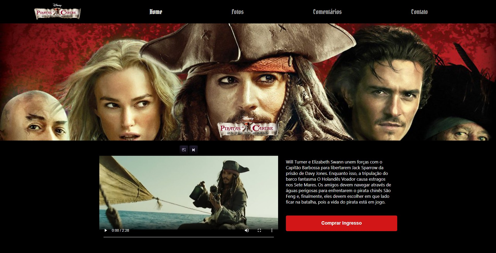
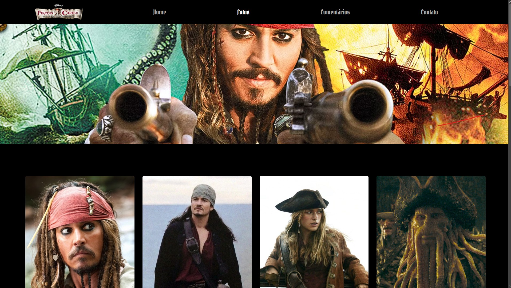
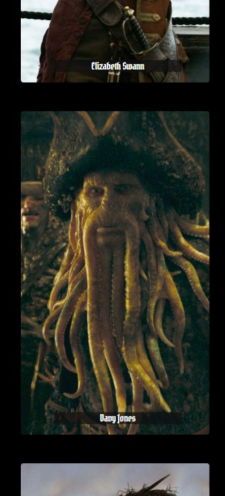

# 🏴‍☠️ Piratas do Caribe

Este projeto é uma plataforma web temática sobre a franquia de filmes Piratas do Caribe, desenvolvida com o objetivo de explorar e consolidar conhecimentos avançados em React, TypeScript, Styled Components e Design Responsivo.

## 📋 Funcionalidades

- **Home:** Apresentação do trailer oficial com controles customizados e sinopse da saga.
- **Fotos:** Grade de personagens utilizando componentes reutilizáveis e propriedades (props) para renderização dinâmica.
- **Comentários:** Seção dedicada ao feedback do público, gerenciando o estado global ou local da aplicação.
- **Contato:** Página com integração direta ao perfil do desenvolvedor no GitHub.

## 📷 Previews

## 🚀 Tecnologias Utilizadas

O projeto foi construído utilizando as melhores práticas do desenvolvimento Front-End moderno:

- **React com TypeScript (TSX):** 
  - Criação de interfaces de usuário baseadas em componentes tipados, garantindo maior segurança e previsibilidade no código.
  - Utilização de Hooks (como useState, useEffect e Context API) para gerenciamento de estado e interatividade.
- **Styled Components:** 
  - **CSS-in-JS:** Estilização encapsulada por componente, evitando conflitos de classes globais e mantendo o escopo limpo.
  - **Estilização Dinâmica:** Uso de propriedades (props) passadas aos componentes para criar variações visuais baseadas no estado da aplicação.
- **Responsividade:**
  - Uso de Media Queries diretamente integradas aos arquivos de Styled Components.
  - Flexbox e Grid aplicados aos componentes para adaptar o layout a diferentes tamanhos de tela (Mobile, Tablet, Desktop).

## 📂 Estrutura de Pastas

iniciando_styled_components/
├── node_modules/
├── public/
├── src/
│   ├── assets/              # Imagens, vídeos, logos e ícones do projeto
│   ├── components/          # Componentes isolados e reutilizáveis
│   ├── contexts/            # Contextos do React para gerenciamento de estados globais
│   ├── pages/               # Páginas principais da aplicação
│   ├── App.css              # Estilos complementares do componente App
│   ├── App.tsx              # Componente raiz
│   ├── index.css            # Estilos globais básicos
│   ├── index.tsx            # Ponto de entrada da aplicação
│   ├── react-app-env.d.ts   # Declarações de tipos do Create React App
│   ├── reportWebVitals.ts   # Medição de performance
│   └── setupTests.ts        # Configurações de testes
├── .gitignore               # Arquivos e pastas ignorados pelo Git
├── package-lock.json        # Árvore de dependências exata
├── package.json             # Gerenciamento de dependências e scripts
├── README.md                # Documentação do projeto
└── tsconfig.json            # Configurações do compilador TypeScript

## 🔍 Boas Práticas Implementadas

- **Tipagem Estática:** Uso de TypeScript para definir interfaces e tipos para props e estados, reduzindo erros em tempo de execução.
- **Componentização:** Código modular e escalável, separando responsabilidades visuais da lógica de negócios.
- **Acessibilidade:** Uso de atributos aria-label e HTML semântico no JSX, garantindo que leitores de tela interpretem o conteúdo corretamente.
- **Segurança:** Links externos configurados com target="_blank" e rel="noopener noreferrer" para proteger a navegação do usuário.

## 🛠️ Como Executar o Projeto

1. Clone este repositório:

git clone https://github.com/SDN-Daniel/React-Styled-Components-TSX.git

2. Navegue até a pasta do projeto:

cd iniciando_styled_components

3. Instale as dependências:

npm install

4. Inicie o servidor local:

npm start

5. Abra o link gerado no terminal em qualquer navegador moderno.

## 👨‍💻 Autor

Desenvolvido por Daniel Santos do Nascimento.

GitHub: https://github.com/SDN-Daniel

Este projeto foi desenvolvido para fins de estudo e exploração técnica das capacidades do ecossistema React, TypeScript e bibliotecas de estilização avançada.